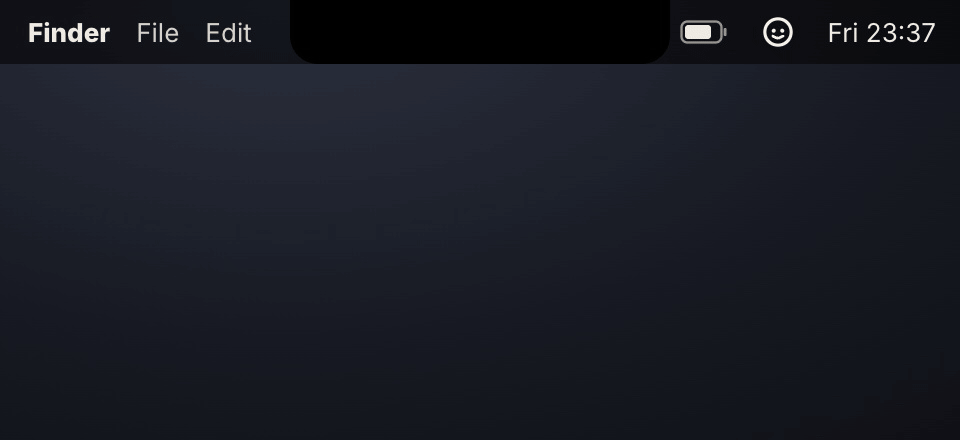
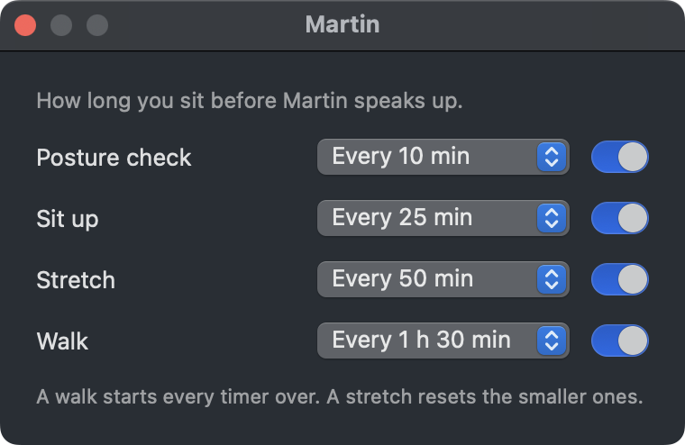

# Martin

Martin is a stick figure who lives in your Mac's menu bar. When you've been sitting too long, he slides out from under the notch on a little paper card, says one line, and does the move with you: a posture check, sitting up, neck rolls, or a walk. Then he goes back up and leaves you alone.

I built him with Claude Code in October 2026, during Code for Creatives cohort 4. He's my first build on GitHub. I've had him running for over a week now, and he shows up exactly when I need him.



## What he does

- **Posture check** every 10 minutes and **sit up** every 25. These fade on their own after 8 seconds.
- **Stretch** every 50 minutes: Martin does neck rolls with you while a 30 second countdown runs.
- **Walk** every 90 minutes, with a one minute countdown. After 22:00 the walk becomes a minute on your feet.
- Stretch and walk wait for you to press Done, Snooze 10 min or Skip. Done plays a soft ding. Snooze sends him walking off the edge of the card.
- Five minutes away from the keyboard counts as a break, and every timer starts over. A walk resets everything; a stretch resets the smaller nudges.
- He stays quiet while your camera is on, while your mic has been on for two minutes (so a call silences him and dictation doesn't), on weekends unless you turn them on, and when you switch on Do not disturb or pause him for an hour.
- Click his face in the menu bar for today's tally ("Today: 9 sit-ups, 3 stretches, 1 walk"), what's coming next, and every switch.

## Settings

Click his face, then **Settings…** (or press Cmd-comma with the menu open). Each nudge has its own timer and its own switch. If all you want is a walk every hour, turn the other three off and set Walk to every hour. Your choices are saved and survive a restart.



## Install it on your Mac

You need a Mac on macOS 13 (Ventura) or newer. Martin works with or without a notch. You don't need Xcode, only Apple's free command line tools.

Open Terminal and run these one at a time. Or paste this README into Claude Code and ask it to install Martin for you.

1. Install Apple's command line tools (skip this if you've already installed them; Terminal will tell you):

   ```bash
   xcode-select --install
   ```

2. Download Martin:

   ```bash
   git clone https://github.com/pranavgajria-the1streporter/martin.git
   ```

3. Build him. This takes about a minute the first time:

   ```bash
   cd martin/app && ./build.sh
   ```

4. Move him into your Applications folder and open him:

   ```bash
   cp -R Martin.app /Applications/ && open /Applications/Martin.app
   ```

His face appears in the menu bar near the clock. To see him straight away, click his face and choose **Nudge me now**. To have him start every time you log in, click his face and tick **Start at login**.

Martin asks for no permissions. He reads how long it's been since you touched the keyboard or mouse, and whether any app is using the camera or mic. He never records anything, and nothing leaves your Mac.

**Can't see his face?** On a MacBook with a notch, menu bar icons that don't fit hide behind it. Quit an icon or two you don't use, or hold Cmd and drag Martin's face to a new spot.

**To update** later: `cd martin && git pull && cd app && ./build.sh`, then copy Martin.app into Applications again.

**To remove him:** quit him from his menu and drag Martin from Applications to the Bin.

## How I built him with Claude Code

I don't write Swift. Claude Code wrote every line, and I made the calls.

1. **The idea.** I saw Claude's reel about Tony the Rigatoni, a little character built in an afternoon, and wanted a friend at my desk who would get me off the chair.
2. **The grill.** Before any code, Claude asked me questions one at a time for an hour at 2am: what he reminds me about, how often, when he should stay quiet, how he talks. Every answer went into `brief.md`.
3. **The look.** Claude drew three directions for Martin as a web page. I picked the size and paper from one and the type and copy from another, and that became `look.md`. Martin himself is drawn in code, with no animation library.
4. **The app.** Claude built a native Mac menu bar app in Swift. The card is a small web page inside it (`app/Resources/martin.html`), which is how Martin gets his springy movement.
5. **Living with him.** After a few days he went silent. Claude had given him a log, so we read it together and found the cause: macOS stops drawing a window it thinks is hidden, so his card got stuck under the menu bar. One fix later, he was back.
6. **Settings.** After a week of real use I wanted a different rhythm for each nudge, and a way to turn some off. That's the Settings window.

The `look-mom/` folder has screenshots from the build, including the first version of the jump, which looked like a shrug.

## Make him yours

- **His lines** are near the top of the script in `app/Resources/martin.html`, a few per nudge. Change them, run `./build.sh` in the `app` folder, and reopen Martin.
- **The timers** are in Settings. The menu bar has everything else.
- Ask Claude Code to change anything. Open the `martin` folder in Claude Code and describe what you want: a new stretch, a different colour of paper, a water reminder.

## When he goes quiet

Click his face first: the second line in the menu says why he's holding back (camera on, a call, weekends, paused). If that doesn't explain it, his log is at `~/Library/Logs/Martin.log`. Every nudge, break and held-back reason is written there, plus an "alive" line every 5 minutes.

```bash
tail -20 ~/Library/Logs/Martin.log
```

## Known gaps

- His fonts load from Google Fonts. Offline, the card uses the system font.
- While a card is up, a clear margin about 30 points around it blocks clicks to whatever is behind it.
- The camera rule is strict: any app using the camera holds every nudge until it stops. When the call ends, the biggest nudge that's due comes up.

## Files

- `app/Sources/Martin/`: the Swift app. `AppDelegate.swift` has the timers and the menu, `Settings.swift` the Settings window, `CardWindow.swift` the window under the notch, `Quiet.swift` the idle, mic and camera checks.
- `app/Resources/`: the card page and the ding.
- `app/build.sh`: builds `Martin.app`.
- `brief.md` and `look.md`: what we decided, and the design.
- `demo/`: the demo clip and the script that records it.

For testing: `open Martin.app --args --nudge walk` shows a walk 1.5 seconds after launch.
